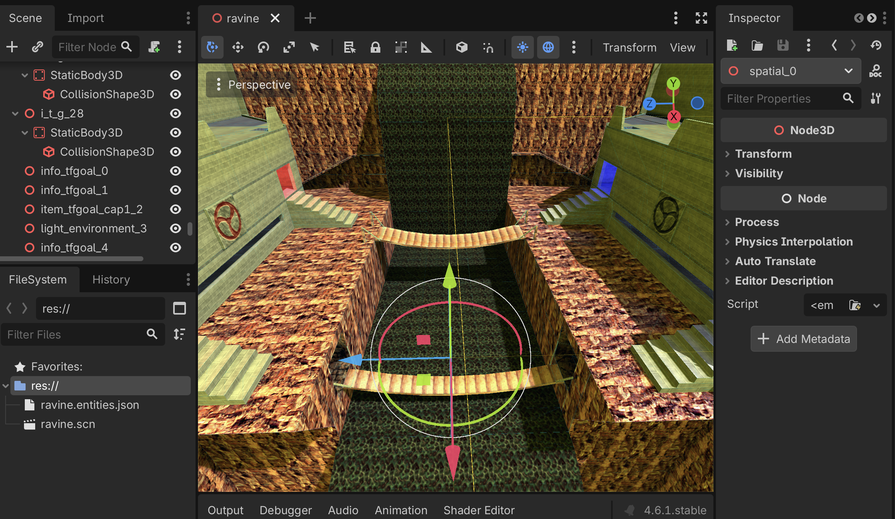

# goldsrc-godot

A Godot 4.3+ GDExtension for loading GoldSrc (Half-Life 1) engine assets: BSP maps, MDL models, SPR sprites, and WAD texture archives.



## Features

### BSP Maps
- BSP30 (Half-Life / GoldSrc) and BSP29 (Quake) formats with face-based mesh generation — Quake v29 maps have their global-palette textures and grayscale lightmaps normalized to the v30 representation
- Atlas-packed lightmaps with 64 lightstyle channels and runtime rebaking
- Embedded and WAD-referenced textures with transparency (`{` prefix alpha-scissor)
- Animated textures (`+0name` … `+9name` / `+aname` … `+jname` alternates) — frames collected at import and stored as `tex_anim_frames` metadata on each `MeshInstance3D`; driven at 10 FPS by `TextureAnimator` at runtime with no C++ dependency
- Water/liquid textures (`!` and `*` prefix) rendered with a turbulent UV-warp shader (sine-wave distortion animated via `TIME`)
- Hull 0 collision (StaticBody3D for worldspawn, AnimatableBody3D for brush entities)
- Clip hull export for exact GoldSrc collision — the compiler's CLIPNODES ride in the baked `bsp_data` blob and every collision body is tagged with the BSP model it stands for, so a physics engine that can trace the hulls (see [GoldSrc Hull Collision](#goldsrc-hull-collision)) does; anything else keeps colliding against the mesh shapes as before
- Water volume extraction as Area3D with ConvexPolygonShape3D
- PVS (Potentially Visible Set) data parsing with RLE decompression — exposed for runtime visibility culling via `VisibilityManager`; a stripped BSP blob (PLANES, VISIBILITY, NODES, CLIPNODES, LEAFS, MODELS only) is baked into each `.scn` as `bsp_data` metadata so `VisibilityManager` can initialize without the original `.bsp`. The blob is still a valid BSP30 file, and one copy serves both the PVS reader and hull collision
- Worldspawn spatial splitting — walks the BSP tree to group faces into spatial clusters, producing separate MeshInstance3D nodes per group for better frustum culling; each group node has `pvs_leaves` metadata (PackedInt32Array) for use with `VisibilityManager.register_leaf_set()`
- Brush entity root nodes are AnimatableBody3D instances — meshes and collision shapes are direct children
- Point entity root nodes are plain Node3D instances
- Entity properties stored as metadata on each node — classname, targetname, origin, angles, and all other key-value pairs are accessible from GDScript via `node.get_meta("entity")`
- Entity lump parsing (key-value dictionaries accessible from GDScript)
- Ambient cube light grid baking — traces rays in 6 directions from a 3D grid through the BSP tree, samples lightmaps at hit points, and outputs slice images for `ImageTexture3D` construction. Includes flood-fill of solid cells to prevent trilinear interpolation artifacts. Provides spatially-varying directional ambient lighting for dynamic models
- Sun fraction — the share of each luxel's light that came from the sky, so a game can turn the sun down (night) and leave the map's own lights alone. hlrad bakes both into style 0; when the `light_environment` has a style of its own the split is exact, otherwise each luxel is re-lit by sun, sky and point-light traces and the weights that best rebuild the real lightmap decide it. Baked only when a `shader_hook` is set. Bound to world materials as `lm_sun`, handed to the hook's `goldsrc_lightmap` (below) and added to the light grid as `sun_slices`
- Rain floor (`bake_rain_floor`) — per column, the height where something falling from the sky first lands: sky faces pass, worldspawn and `func_water` stop it, doors and platforms don't. A heightmap a game can use for precipitation, roofs and puddles
- Shader hooks (`shader_hook`) — your own shader code in every BSP shader, for night, weather and the like, without the extension knowing about them. See [Shader Hooks](#shader-hooks)

### MDL Models
- Skeleton3D with full bone hierarchy
- Skinned meshes with per-vertex bone weights
- All animation sequences as AnimationPlayer tracks
- Chrome and additive material flags
- Configurable scale factor
- Hit boxes as `BoneAttachment3D` + queryable-only `Area3D` on collision layer 10, each carrying
  `hitbox_group` (the file's own `mstudiobbox_t.group` — `1` is the head by Half-Life convention,
  `0` is `HITGROUP_GENERIC`) and `hitbox_bone` (the bone it rides). The group is reported as the
  file states it and never inferred: a model whose boxes are all `0` carries no anatomy, and
  deciding otherwise is the consuming game's call. Both the editor importer and any runtime
  converter bake these into their output, so tag the group in the `.mdl` rather than guessing
  downstream — Wizard Wars does this with `tools/tag_mdl_head_hitboxes.py`

### SPR Sprites
- All frame types (single and grouped)
- Texture formats: normal, additive, index-alpha, alpha-test
- Sprite types: parallel, facing-upright, oriented, etc.
- Frame textures and origins accessible individually from GDScript
- `build_scene()` produces a self-animating Sprite3D with a `SpriteAnimationPlayer` child (GDScript node, no C++ dependency at runtime) — exported properties: `fps` (default 10.0), `loop_animation` (default true), `autoplay` (default "default"); non-looping animations auto-hide the sprite on completion

### WAD Textures
- WAD2/WAD3 format support
- Palette-based to RGBA conversion with auto-generated mipmaps
- Case-insensitive texture lookup
- Per-texture caching

## Editor Import Plugins

Drop files into a project and they auto-import:

| Format | Extension | Output | Description |
|--------|-----------|--------|-------------|
| BSP | `.bsp` | `.scn` | PackedScene with meshes, lightmaps, collision |
| MDL | `.mdl` | `.scn` | PackedScene with Skeleton3D, meshes, animations |
| SPR | `.spr` | `.scn` | PackedScene with self-animating Sprite3D and SpriteAnimationPlayer child |
| WAD | `.wad` | `.png` files | Extracts individual textures as PNGs |

All imported scenes contain only standard Godot types (Node3D, MeshInstance3D, ArrayMesh, Skeleton3D, AnimationPlayer, StaticBody3D, AnimatableBody3D, etc.) and do **not** require the GDExtension at runtime.

### BSP Import Options

| Option | Default | Effect |
|--------|---------|--------|
| `scale_factor` | `0.025` | Godot units per GoldSrc unit. |
| `wad_directory` | `""` | Load every `.wad` in this folder. Empty loads the WADs worldspawn declares, looked up beside the `.bsp` and then at `res://`. |
| `fallback_wads` | `""` | Comma-separated WADs searched after the declared ones, for stand-ins for WADs you can't ship. Set it for every map under `[importer_defaults]` in `project.godot`. Missing declared WADs aren't warned about while one loads. |
| `model_directory` | `""` | Base path for entity `model` keys (see below). |
| `shader_lightstyles` | `true` | Composite the four lightmap styles in the world shader, so styles can be animated at runtime. The 64-entry style texture rides in root metadata as `lightstyle_texture` (and `lightstyle_image`). |
| `overbright` | `2.0` | Lightmap multiplier on world materials. GoldSrc's is 2.0. |
| `light_grid_cell_size` | `0.0` | Bake an ambient-cube light grid into root metadata as `light_grid`, for lighting models by position. Cell size in GoldSrc units; `0` skips it. |
| `rain_floor_cell_size` | `0.0` | Bake the rain floor into root metadata as `rain_floor` (see [Shader Hooks](#shader-hooks)). Cell size in GoldSrc units; `0` skips it. |
| `shader_hook` | `""` | A `.gdshaderinc` every shader in the map includes. See [Shader Hooks](#shader-hooks). |

Every imported map's root is also stamped with `pipeline_id`, a hash of the extension's C++
source. Godot re-tests an import only when its source or `.import` file changes, so a rebuilt
extension (or a changed importer) would otherwise leave every map as the old build made it. The
importer records what built each map in the editor's project metadata, and the plugin reimports
any map recorded with something else on editor start and after an extension hot reload. A
project that converts maps itself at runtime and never loads the imported scenes can turn this
off with the `goldsrc/import/reimport_on_extension_change` project setting.

### BSP Entity Model Instantiation

The BSP importer automatically instantiates MDL/SPR scenes for point entities (monsters, props, sprites, etc.). Entity `model` keys are resolved as `res://` + the entity path, mirroring the GoldSrc layout at the project root — so `models/headcrab.mdl` maps to `res://models/headcrab.mdl`.

If the asset is not found, a small placeholder `BoxMesh` (0.3 m³) is placed at the entity position so it remains visible in the editor.

**Typical workflow:**
1. Drop your game's `models/` and `sprites/` folders into the project root (`res://`).
2. Godot auto-imports all `.mdl` and `.spr` files.
3. Import your `.bsp` — entities with models/sprites appear in the scene automatically.

### Runtime Conversion

A game that converts maps at runtime instead (downloaded maps, a cache in `user://`) calls the
same `build_scene()` the importer does, so both produce the same scene, less the entity models
the importer adds:

```gdscript
var bsp := GoldSrcBSP.new()
bsp.scale_factor = 0.025
bsp.light_grid_cell_size = 32.0
bsp.load_bsp("res://maps/mymap.bsp")
bsp.load_declared_wads()          # beside the .bsp, then res://; returns any it couldn't find
var root := bsp.build_scene()     # plain Node3D, owners set, metadata on the root
bsp.free()

var scene := PackedScene.new()
scene.pack(root)
ResourceSaver.save(scene, "user://maps/mymap.scn")

# Later: was that cached scene built by another build of the extension?
if GoldSrcBSP.scene_pipeline_id(load("user://maps/mymap.scn")) != GoldSrcBSP.get_pipeline_id():
    pass  # rebuild it
```

## Shader Hooks

The map's shaders are plain GoldSrc: texture times lightmap, warped liquid, a cubemap sky. To
change what they draw (night, rain, a lightning flash, a damage tint), point the map at a
`.gdshaderinc` of your own. Every shader the map is built with then includes it, with one of
three defines set, and calls the functions that kind of shader needs:

| Define | Shader | You supply |
|--------|--------|------------|
| `GOLDSRC_HOOK_WORLD` | world and brush-entity surfaces (opaque and `{` alpha-tested) | `vec3 goldsrc_lightmap(vec3 lm, float sun_share, vec3 world_pos)` and `void goldsrc_surface(inout vec3 lit_srgb, inout vec3 albedo, vec3 world_pos, vec3 world_normal, vec3 normal_view, vec3 view)` |
| `GOLDSRC_HOOK_LIQUID` | `!`/`*` textures and `func_water` | `vec3 goldsrc_liquid(vec3 albedo, int liquid_type)` |
| `GOLDSRC_HOOK_SKY` | sky faces | `vec3 goldsrc_sky(vec3 color, vec3 eye_dir)` |

- `goldsrc_lightmap` gets the styled lightmap as stored (gamma, before `overbright`) and
  `sun_share`, how much of it came from the sky (the [sun fraction](#bsp-maps); 0 on a map
  without a `light_environment`), and the fragment's world position (for anything that varies
  over the map, such as cloud shadows), and returns the lightmap to use.
- `goldsrc_surface` runs last. `lit_srgb` is what the surface shows, texture × lightmap in gamma
  space; `albedo` is what Godot's real-time lights see. `world_pos`/`world_normal` are world space;
  `normal_view`/`view` are the fragment's `NORMAL` and `VIEW`.
- `goldsrc_liquid` gets the liquid's final colour and its kind: 0 water, 1 slime, 2 lava.
- `goldsrc_sky` gets the cubemap colour along `eye_dir` (world space).

Your uniforms go in the same file, inside the right `#ifdef`, and you set them on the map's
materials like any other. A minimal hook that turns the sun down and leaves the map's own lights
burning:

```glsl
// res://shaders/night.gdshaderinc
#ifdef GOLDSRC_HOOK_WORLD
uniform vec3 sky_light = vec3(1.0);  // linear multiplier on the sky's part of the light

vec3 goldsrc_lightmap(vec3 lm, float sun_share, vec3 world_pos) {
	// The lightmap holds pow(light, 0.55), so the multiplier goes through the same curve.
	return lm * pow(max(mix(vec3(1.0), sky_light, sun_share), vec3(0.0)), vec3(0.55));
}

void goldsrc_surface(inout vec3 lit_srgb, inout vec3 albedo, vec3 world_pos, vec3 world_normal,
		vec3 normal_view, vec3 view) {}
#endif

#ifdef GOLDSRC_HOOK_LIQUID
vec3 goldsrc_liquid(vec3 albedo, int liquid_type) { return albedo; }
#endif

#ifdef GOLDSRC_HOOK_SKY
vec3 goldsrc_sky(vec3 color, vec3 eye_dir) { return color; }
#endif
```

Point a map at it with the importer's `shader_hook` option, or `bsp.shader_hook` before
`build_scene()` when converting at runtime. Then drive it from GDScript:

```gdscript
func set_night(map: Node, amount: float) -> void:
	var moon := Vector3(0.12, 0.14, 0.24)
	for mi in map.find_children("*", "MeshInstance3D", true, false):
		if mi.mesh == null:
			continue
		for i in mi.mesh.get_surface_count():
			var mat := mi.mesh.surface_get_material(i) as ShaderMaterial
			if mat:
				mat.set_shader_parameter("sky_light", Vector3.ONE.lerp(moon, amount))
```

The materials are shared per texture, so that sets each once however many surfaces use it. A
material whose shader doesn't declare the uniform ignores it.

For weather, `bake_rain_floor(cell_size)` (or the importer's `rain_floor_cell_size`) gives a
heightmap of where rain lands, as root metadata `rain_floor`: `image` (an `FORMAT_RF` image of
heights in Godot units), `origin` (its max-X/min-Z corner in world space), `size` (its world
extent on X/Z) and `top` (the map's ceiling). A point is under open sky when its height is above
the floor's at its column:

```glsl
vec2 uv = vec2((rain_floor_origin.x - p.x) / rain_floor_size.x, (p.z - rain_floor_origin.z) / rain_floor_size.y);
bool open_to_sky = p.y > textureLod(rain_floor, uv, 0.0).r - 0.1;
```

**The example.** `examples/shader_hook/` is a working one: `hook.gdshaderinc` does night, wet
ground under open sky, dimmed liquids and a sky flash, and the demo map imports with it. Open
`demo.tscn` and drag the `night`, `wetness` and `lightning` sliders on its root; `demo.gd` sets the
uniforms and the map changes in the editor viewport. (The demo ships without its WADs, so the
textures are placeholders; the lighting still shows.)

**What to know:**
- The include is resolved when a shader compiles, at load, not when the map converts. Editing
  the file needs no reimport; renaming it or changing what it defines does, since the path and
  the calls are baked into the map.
- Every shader in the map compiles your code, so an error in it breaks all of them at load.
  Check the output for shader errors after changing it.
- A hook has to define every function its kind calls, even as a pass-through. Uniforms are per
  kind, so declare one in each `#ifdef` that uses it (the example's `sky_light` is in all three).
- Unset, nothing is included and the shaders are exactly as before.

## PVS Runtime Visibility Culling

### Concept

BSP maps are divided into convex regions called *leaves*. During map compilation, the compiler precomputes which leaves can see each other — the Potentially Visible Set (PVS) — stored as a run-length–encoded bitfield. Knowing an observer's current leaf lets you look up the full set of visible leaves in O(1) with no raycasting.

`VisibilityManager` wraps this data with two abstractions:

- **Observers** — viewpoints (camera or network peers) whose PVS is cached and updated lazily: the PVS bitfield is only recomputed when the observer crosses a BSP leaf boundary. Positions within the same leaf reuse the cached result at no cost.
- **Leaf sets** — sets of BSP leaves that represent a tracked object, either derived from an AABB pushed through the BSP tree (for moving entities) or pre-baked from import metadata (for static mesh groups). Visibility is a single bitset scan across the leaf set.

### Data Flow

```
.bsp import
    └─ BSP importer strips the tree lumps (PLANES, VISIBILITY, NODES, CLIPNODES, LEAFS,
       MODELS) and bakes them into .scn as bsp_data metadata on the root node
           └─ runtime: setup_from_data(bsp_data, scale_factor)
                  └─ VisibilityManager ready — no .bsp file needed at runtime
```

The `bsp_data` blob is written by `build_mesh()`, so every converted map carries it. Retrieve it from the instantiated map scene:

```gdscript
var pvs_blob: PackedByteArray = map_root.get_meta("bsp_data", PackedByteArray())
var leaf_count = vm.setup_from_data(pvs_blob, 0.025)
if leaf_count == 0:
    push_error("PVS setup failed — bsp_data missing or corrupt")
```

### Use Case 1: Rendering Culling

The BSP importer groups worldspawn faces into spatial clusters and emits a separate `MeshInstance3D` per group. Each group node has `pvs_leaves` metadata (a `PackedInt32Array`) stamped by the builder. Register these as leaf sets once on map load, then cull per-frame.

```gdscript
var vm: VisibilityManager
var cam_handle: int
var mesh_leaf_sets: Dictionary  # MeshInstance3D -> leaf_set handle

func _ready() -> void:
    vm = VisibilityManager.new()
    add_child(vm)

    var pvs_blob = map_root.get_meta("bsp_data", PackedByteArray())
    if vm.setup_from_data(pvs_blob, 0.025) == 0:
        return

    cam_handle = vm.add_observer(0, camera.global_position)

    for mesh_node in map_root.find_children("*", "MeshInstance3D", true, false):
        if mesh_node.has_meta("pvs_leaves"):
            var leaves: PackedInt32Array = mesh_node.get_meta("pvs_leaves")
            mesh_leaf_sets[mesh_node] = vm.register_leaf_set(leaves)

func _process(_delta: float) -> void:
    vm.update_observer_position(cam_handle, camera.global_position)
    for mesh_node in mesh_leaf_sets:
        var handle: int = mesh_leaf_sets[mesh_node]
        mesh_node.visible = vm.is_leaf_set_visible_to_observer(handle, cam_handle)
```

### Use Case 2: Network Entity Culling

On a multiplayer server, give each connected peer its own observer. Skip sending entity updates to peers whose PVS doesn't cover the entity's leaves.

```gdscript
var vm: VisibilityManager
var peer_handles: Dictionary   # peer_id -> observer handle
var entity_handles: Dictionary # node -> entity handle

func _ready() -> void:
    vm = VisibilityManager.new()
    add_child(vm)
    var pvs_blob = map_root.get_meta("bsp_data", PackedByteArray())
    vm.setup_from_data(pvs_blob, 0.025)

func on_peer_connected(peer_id: int, initial_pos: Vector3) -> void:
    peer_handles[peer_id] = vm.add_observer(peer_id, initial_pos)

func on_peer_disconnected(peer_id: int) -> void:
    vm.remove_observer(peer_handles[peer_id])
    peer_handles.erase(peer_id)

func on_peer_moved(peer_id: int, pos: Vector3) -> void:
    vm.update_observer_position(peer_handles[peer_id], pos)

func register_game_entity(node: Node3D) -> void:
    entity_handles[node] = vm.register_entity(node.get_aabb())

func on_entity_moved(node: Node3D) -> void:
    vm.update_entity_aabb(entity_handles[node], node.get_aabb())

func send_updates_to_peer(peer_id: int) -> void:
    var obs = peer_handles.get(peer_id, -1)
    if obs == -1:
        return
    for node in entity_handles:
        if vm.is_entity_visible_to_observer(entity_handles[node], obs):
            send_entity_update(peer_id, node)
```

### Handle Lifetime

All handles are stable integers until the matching `remove_observer` / `unregister_entity` / `unregister_leaf_set` call. Handles from removed entries are recycled internally — do not use a handle after removal.

Call `teardown()` (or free the node) when unloading a map. All registered observers, entities, and leaf sets are released automatically.

## GoldSrc Hull Collision

### Concept

The mesh collision this importer builds (trimesh for worldspawn, convex shapes for brush
entities) approximates the map. GoldSrc itself never collided against the faces: the map
compiler expanded every brush by each of four fixed box sizes and wrote the results as
separate BSP trees — the *clip hulls* — so a trace is a plane-by-plane tree descent with
exact normals. That is where Half-Life's 18-unit step-up, its wall sliding, and its
"am I stuck?" answers come from, and it is what a mesh collider cannot reproduce.

Those trees are in the file, so the importer ships them. Two pieces:

- The **CLIPNODES lump** rides in the stripped `bsp_data` blob on the scene root, next
  to the PVS lumps. One blob serves both readers, and it stays a valid BSP30 file.
- Each **collision body is tagged** with the BSP model it stands for, so a consumer knows
  which tree to descend.

This is purely additive. The mesh shapes are still built and still there; a physics engine
that ignores the metadata — including stock Godot Physics — collides against exactly what
it always did.

### Metadata Contract

| Where | Key | Type | Meaning |
|---|---|---|---|
| Scene root | `bsp_data` | `PackedByteArray` | The stripped BSP tree. Written once per map: it is ~800 KB on a mid-size map and a map has hundreds of brush entities, so it is never copied per body — a consumer walks up the tree from a body to find it. |
| Collision body | `bsp_model` | `int` | BSP model index whose hulls this body's shapes stand for (0 = worldspawn, 1+ = brush entities). |
| Collision body | `bsp_scale` | `float` | Godot units per GoldSrc unit, i.e. the importer's `scale_factor`. Always written — a consumer needs it to convert queries back into map units. |
| Collision body | `bsp_blocking` | `int` | Optional. Bitmask over `-contents` (`CONTENTS_SOLID = -2` → bit 2) of what should stop a trace. Omitted means solid-only. Only the sky body sets it, to `1 << -CONTENTS_SKY`: the compiler writes sky as solid in the clip hulls, so sky blocks players there while staying passable in hull 0 — the same split as the mesh path's separate sky collision layer. |

### Enabling it

Nothing to enable on this side — importing (or reconverting) a `.bsp` writes the blob and
the tags. **Maps imported before this feature must be reimported**; without `bsp_data` a
consumer silently falls back to the mesh shapes.

The consumer side is [hop-godot](https://github.com/alanfischer/hop-godot), which traces
the hulls whenever it finds this metadata:

1. Build and install the `hop-physics` addon, then select **Hop Physics** under
   **Project Settings > Physics > 3D > Physics Engine** and restart.
2. Load a reimported map. Hull tracing is on by default; hop prints
   `[Hop] BSP hull collision active for <map>` once per map when it picks the blob up.
3. To turn it off — to A/B it against the mesh colliders, or on a build with no hull
   support — either set `HOP_NO_BSP_HULLS=1` in the environment (boot default only) or
   call `PhysicsServer3D.set_bsp_hulls_enabled(false)` at runtime.

See hop-godot's README for hull selection, the runtime toggle, and its own fallback rules.

## Related projects

Part of a set of Godot 4 libraries for GoldSrc-style games:

- **goldsrc-godot**: BSP/MDL/SPR/WAD loading, PVS, hull data
- [hop-godot](https://github.com/alanfischer/hop-godot): hop physics as a `PhysicsServer3D` backend, with BSP hull traces
- [pmove-godot](https://github.com/alanfischer/pmove-godot): GoldSrc player movement and client prediction
- [goldnet-godot](https://github.com/alanfischer/goldnet-godot): snapshot replication behind Godot's `MultiplayerAPI`

## Building

Requires CMake 3.22+ and a C++17 compiler.

```bash
git clone --recursive https://github.com/alanfischer/goldsrc-godot.git
cd goldsrc-godot
mkdir build && cd build
cmake ..
make -j8
```

The compiled library goes to `addons/goldsrc/bin/`. Open the project in Godot and enable the GoldSrc plugin under Project Settings > Plugins.

## GDScript API

### GoldSrcBSP

```gdscript
var bsp = GoldSrcBSP.new()
bsp.scale_factor = 0.025

var wad = GoldSrcWAD.new()
wad.load_wad("textures.wad")
bsp.add_wad(wad)

bsp.load_bsp("map.bsp")
bsp.build_mesh()

# build_scene() instead of build_mesh() gives a plain, owned Node3D to pack and save
# (see Runtime Conversion). Both put the root metadata (bsp_data, pipeline_id, lightstyles,
# light_grid) on the node they return or fill.
bsp.overbright = 2.0                   # lightmap multiplier on world materials (default 2.0)
bsp.light_grid_cell_size = 32.0        # bake light_grid; 0 (default) skips it
bsp.shader_hook = "res://shaders/my_hook.gdshaderinc"  # see Shader Hooks; "" (default) for none
var missing = bsp.load_declared_wads(["res://wads"])  # worldspawn's WADs; returns those not found
var pipeline = GoldSrcBSP.scene_pipeline_id(packed_scene)  # "" before the stamp existed

# Entity data is on the child nodes as metadata:
for child in bsp.get_children():
    if child.has_meta("entity"):
        var ent = child.get_meta("entity")  # Dictionary
        print(ent.get("classname", ""))
        print(ent.get("targetname", ""))

# Or get raw entity dictionaries:
var entities = bsp.get_entities()  # Array of Dictionaries

# PVS query API (useful for runtime visibility culling)
var leaf_count = bsp.get_leaf_count()                  # total BSP leaf count
var leaf = bsp.point_to_leaf(Vector3(0, 0, 0))         # leaf index for a world position
var visible_leaves = bsp.get_leaf_pvs(leaf)            # PackedInt32Array of PVS-visible leaf indices
var aabb_leaves = bsp.get_leaves_in_aabb(my_aabb)      # PackedInt32Array of leaves touching an AABB

# Export a stripped BSP blob (PLANES, VISIBILITY, NODES, CLIPNODES, LEAFS, MODELS only).
# Still a valid BSP30 file. Embed it in .scn metadata as "bsp_data" so VisibilityManager
# (PVS) and hull collision can both initialize without the .bsp.
var bsp_blob: PackedByteArray = bsp.get_bsp_blob()
# get_pvs_blob() is a deprecated alias for the same call.

# build_mesh() already parks this blob on the node, so prefer reading it back —
# PackedByteArray is copy-on-write, so this is a refcount rather than a second copy.
var same_blob: PackedByteArray = bsp.get_meta("bsp_data", PackedByteArray())

# Load a stripped blob for PVS/hull queries (no WADs or build_mesh needed)
bsp.load_bsp_from_data(bsp_blob)

# Bake ambient cube light grid (call after build_mesh)
var grid = bsp.bake_light_grid(32.0)  # cell size in GoldSrc units
# Returns Dictionary with:
#   grid_origin: Vector3 — world-space origin in Godot coords
#   grid_dims: Vector3i — grid dimensions in Godot coords (X, Y, Z)
#   cell_size: float — cell size in Godot units
#   dir_slices: Array of 6 Arrays of Images — one per axis direction
#     (+X, -X, +Y, -Y, +Z, -Z), each array contains depth-slice Images
#     for ImageTexture3D construction
#   sun_slices: Array of L8 Images — the sky's share of each cell's light
#     (only with a shader_hook, on maps with a light_environment)

# Where rain lands, per column (see Shader Hooks)
var rain_floor = bsp.bake_rain_floor(16.0)  # cell size in GoldSrc units
# Returns Dictionary with image (FORMAT_RF heights), origin (max-X/min-Z corner), size, top
```

### VisibilityManager

BSP PVS-based runtime visibility culling. See [PVS Runtime Visibility Culling](#pvs-runtime-visibility-culling) for end-to-end examples.

```gdscript
var vm = VisibilityManager.new()
add_child(vm)

# Preferred: initialize from bsp_data metadata baked into the .scn at import time.
# No .bsp file required at runtime.
var pvs_blob: PackedByteArray = map_root.get_meta("bsp_data", PackedByteArray())
var leaf_count = vm.setup_from_data(pvs_blob, 0.025)  # returns leaf count; 0 = failure

# Alternative: load directly from a .bsp file (no WADs or mesh build needed)
var leaf_count = vm.setup("maps/mymap.bsp", 0.025)

# Observers — a viewpoint with a cached PVS bitfield (one bool per BSP leaf).
# PVS is recomputed only when the observer crosses a BSP leaf boundary.
# peer_id=0 is conventional for the local camera; use the multiplayer peer ID for remote players.
var cam_handle = vm.add_observer(0, camera.global_position)
vm.update_observer_position(cam_handle, camera.global_position)

# Entities — tracked by world-space AABB; leaf set recomputes when AABB changes.
var ent_handle = vm.register_entity(my_node.get_aabb())
vm.update_entity_aabb(ent_handle, my_node.get_aabb())
var visible = vm.is_entity_visible_to_observer(ent_handle, cam_handle)

# Leaf sets — for pre-baked leaf arrays (worldspawn spatial groups from pvs_leaves metadata).
# The leaf set never changes after registration.
var set_handle = vm.register_leaf_set(packed_int32_leaves)
var ls_visible = vm.is_leaf_set_visible_to_observer(set_handle, cam_handle)

# Point queries
var leaf_vis = vm.is_leaf_visible_to_observer(leaf_index, cam_handle)
var pos_vis  = vm.is_position_visible_to_observer(some_pos, cam_handle)

# Cleanup — or call teardown() / free the node to release everything at once.
vm.remove_observer(cam_handle)
vm.unregister_entity(ent_handle)
vm.unregister_leaf_set(set_handle)
vm.teardown()
```

### GoldSrcMDL

```gdscript
var mdl = GoldSrcMDL.new()
mdl.scale_factor = 0.025
mdl.load_mdl("model.mdl")
mdl.build_model()

print(mdl.get_sequence_count())    # Number of animations
print(mdl.get_sequence_name(0))    # First animation name
print(mdl.get_bone_count())        # Number of bones
```

### GoldSrcSPR

```gdscript
var spr = GoldSrcSPR.new()
spr.load_spr("sprite.spr")

var frame_count = spr.get_frame_count()
var texture = spr.get_frame_texture(0)  # ImageTexture
var origin = spr.get_frame_origin(0)    # Vector2i — up/left extent from entity position
var spr_type = spr.get_type()           # SPR_VP_PARALLEL, etc.

# Build a self-animating Sprite3D scene (no C++ dependency at runtime):
var sprite = spr.build_scene()          # Sprite3D with SpriteAnimationPlayer child
# Override animation properties before adding to tree:
var sap = sprite.get_node("SpriteAnimationPlayer")
sap.fps = 20.0
sap.loop_animation = false
# Frames and origins are stored as metadata on the Sprite3D:
#   sprite.get_meta("tex_anim_frames")   # Array[ImageTexture]
#   sprite.get_meta("tex_anim_origins")  # Array of [ox, oy] pairs
```

### GoldSrcWAD

```gdscript
var wad = GoldSrcWAD.new()
wad.load_wad("textures.wad")

var names = wad.get_texture_names()     # PackedStringArray
var tex = wad.get_texture("concrete1")  # ImageTexture
```

## Coordinate System

GoldSrc uses Z-up; Godot uses Y-up. The plugin converts automatically:
- Positions: `(x, y, z)` &rarr; `(-x * scale, z * scale, y * scale)`
- Quaternions: conjugation by -90&deg; X rotation

Default scale factor is `0.025` (1 GoldSrc unit = 0.025 Godot units).

## License

MIT — see [LICENSE](LICENSE).
